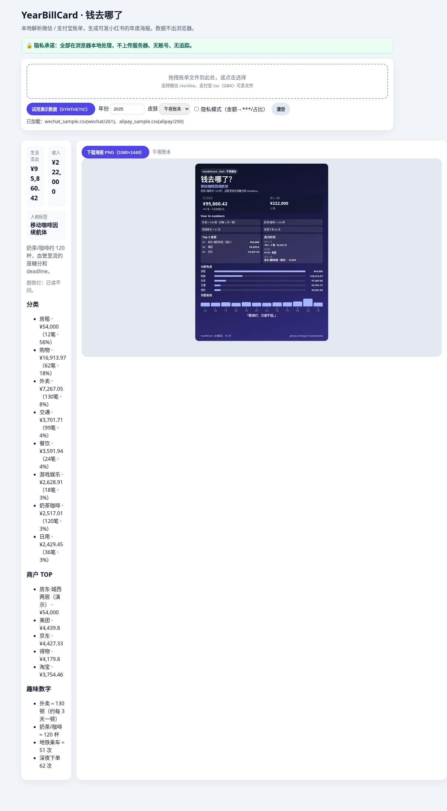
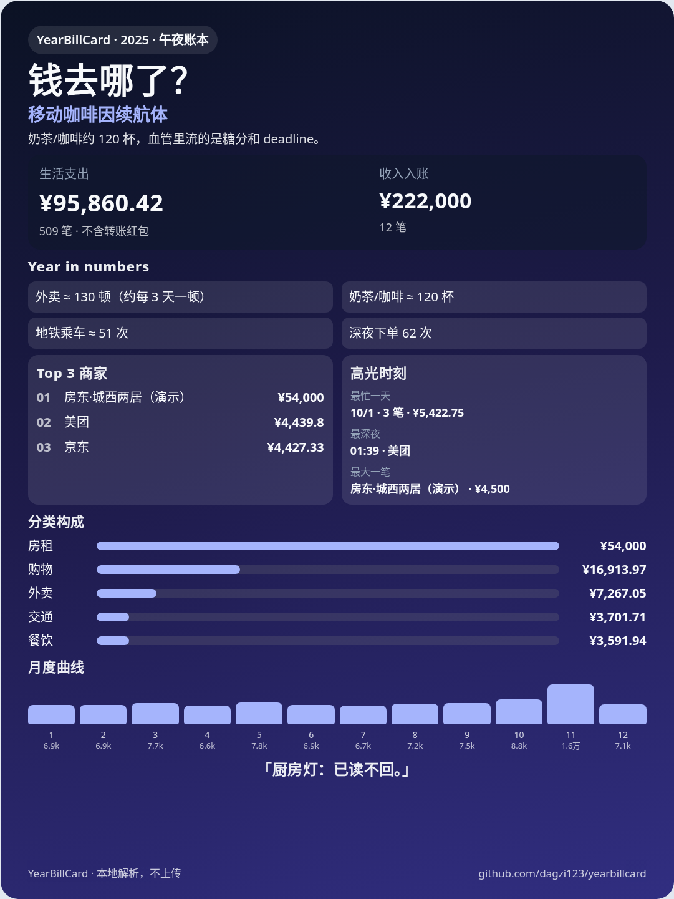
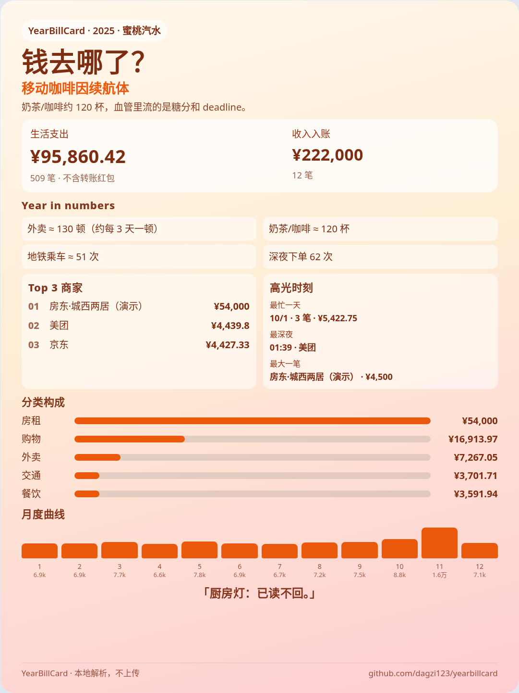
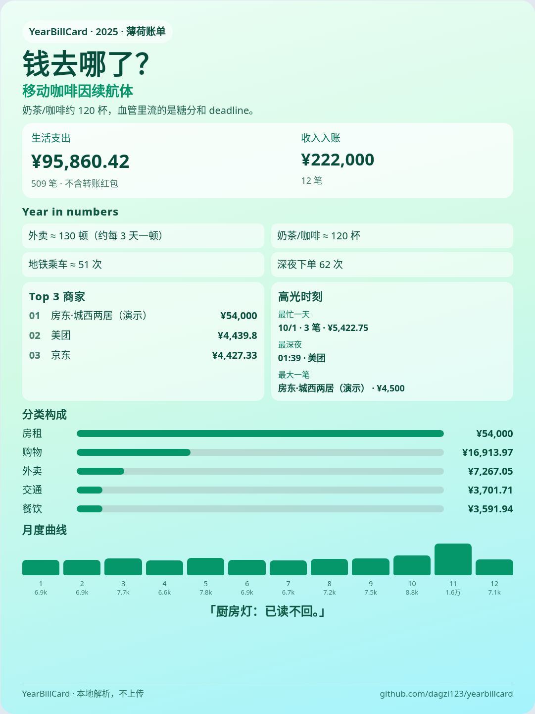
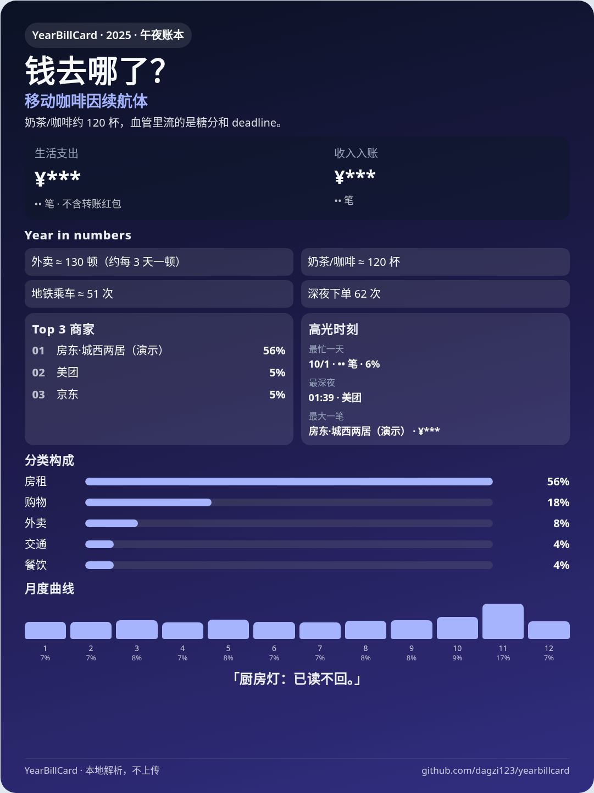

# YearBillCard · 钱去哪了

**一句话**：在浏览器本地导入微信 / 支付宝账单，生成可发小红书的「钱去哪了」年度海报——**数据不上云**。

> English: A privacy-first static web app that turns WeChat Pay & Alipay bill exports into a shareable 3:4 annual spending poster. Everything runs in your browser.



| 午夜账本 | 蜜桃汽水 | 薄荷账单 |
|----------|----------|----------|
|  |  |  |

隐私模式（金额打码 / 占比）：



## 隐私声明

- 纯静态前端（Vite），**无后端、无账号、无上传**。
- 账单文件只在你的浏览器内存中解析；刷新即消失。
- 仓库内 `sample/*` 为 **SYNTHETIC 演示数据**，不是真实账单。

## 30 秒上手

```bash
npm install
npm run dev
```

打开页面 → 点「试用演示数据」→ 换皮肤 → 「下载海报 PNG」。

或拖入你自己导出的微信 csv/xlsx、支付宝 csv。

```bash
npm run build       # 产出 dist/，可部署到 GitHub Pages（base=/yearbillcard/）
npm test            # 解析器单测
npm run screenshots # 重建 docs/ 截图（含隐私模式）
```

在线预览（发布后）：`https://<user>.github.io/yearbillcard/`

仓库：https://github.com/dagzi123/yearbillcard

## 如何导出账单

### 微信（用于个人对账）

1. 微信 → **我** → **服务** → **钱包** → **账单**
2. 右上角 **…** → **下载账单** → **用于个人对账**
3. 选择时间范围（单次常见最长约 1 年）→ 发到邮箱或服务号
4. 解压后得到 **CSV 或 Excel（.xlsx）**（版本不同，两者都支持）
5. **不要**选「用作证明材料」的盖章 PDF（本工具暂不解析 PDF）

常见表头字段：`交易时间,交易类型,交易对方,商品,收/支,金额(元),支付方式,当前状态,交易单号,商户单号,备注`

### 支付宝（电子版 CSV）

1. 支付宝 → **我的** → **账单**
2. 右上角 **…** → **开具交易流水证明 / 下载账单**（文案随版本略有差异）
3. 选时间范围 → **CSV / 电子版** → 邮箱接收并解压
4. 文件多为 **GBK** 编码；本工具用浏览器 `TextDecoder` 自动尝试识别（无需 Node polyfill）

常见表头字段：`交易时间,交易分类,交易对方,对方账号,商品说明,收/支,金额,收/付款方式,交易状态,交易订单号,商家订单号,备注`

> 官方界面可能改版；若解析失败，请提 Issue 并附上**打码后的表头行**（不要发真实明细）。

## 功能

- 拖拽多文件；自动识别微信 / 支付宝；合并去重（优先交易单号）
- 按自然年筛选；排除全额退款 / 关闭单；转账红包默认不计入「生活支出」人格
- 规则分类：外卖 / 奶茶咖啡 / 交通 / 房租 / 购物 / 游戏娱乐…
- 统计：总支出与收入、分类 TOP、商户 TOP、最大一笔、月度曲线（带标签）、深夜消费、最忙一天、趣味对比文案
- 规则生成毒舌人格标签（无需 LLM）
- 3:4（1080×1440）海报，三套皮肤；**隐私模式**可用 `***` / 百分比替代金额
- 演示数据一键试用（全年约 300–600 笔 SYNTHETIC）
- `xlsx` 动态按需加载，缩小首包

## 与「完整记账 App」的区别

BeeCount、ezBookkeeping 等是长期账本。YearBillCard 只做 **一张能发的年报卡**。

## 限制（请先读）

- 微信导出格式在 CSV / xlsx、说明行行数、金额 `¥` 前缀上存在版本差异；启发式「扫描表头」可能偶发失败。
- 支付宝旧版网页导出列名可能不同（已做部分别名）；**证明材料 PDF 不支持**。
- 分类靠关键词，长尾商户会进「其他」。
- 微信↔支付宝互转、银行卡流水重复记账，本 MVP 不做跨机构资金链去重。

## License

MIT
